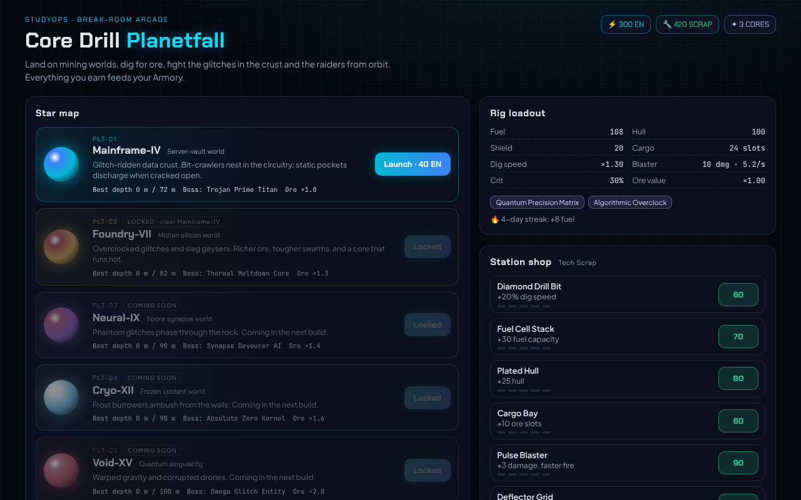
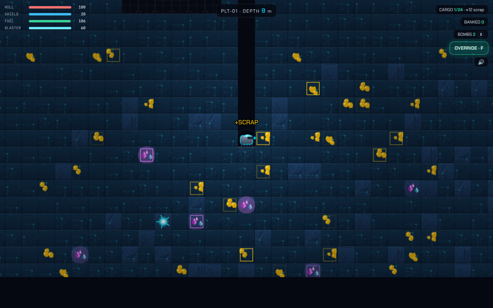
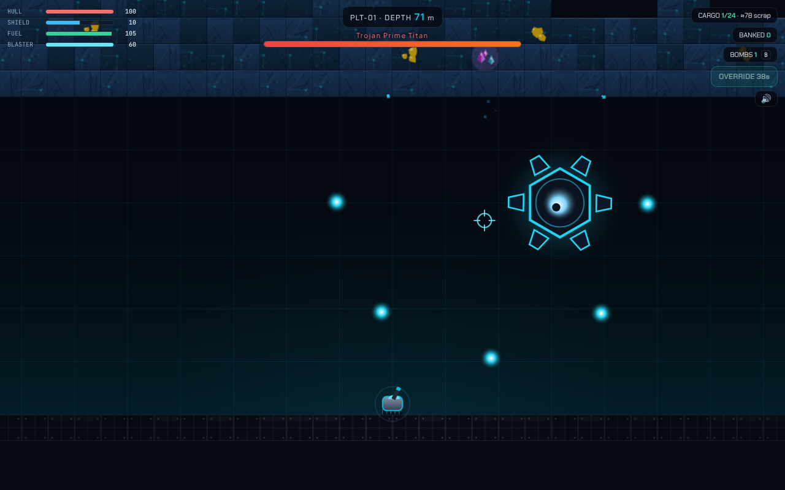

# Core Drill: Planetfall (MVP prototype)

A break-room arcade game for the **StudyOps** app. You pilot a mining rig down into alien planets, dig for ore, fight the glitches living in the crust and the raiders dropping in from orbit, then sell your haul for Tech Scrap. It is deliberately a different pace from Glitch Defense: that game is a frantic base defense, this one is a 5-8 minute dig-and-fight run that fits a Pomodoro break.





## What is in the MVP

| Area | Status |
|---|---|
| Orbit star map with 5 planets | 2 playable (Mainframe-IV, Foundry-VII), 3 shown as "coming soon" |
| Side-view dig-down world | Tile world with dirt, rock, scrap ore, crystals, quantum cores, bedrock, hazard pockets |
| Rig | Gravity, thrusters, fuel, hull, shield, cargo hold, fall damage, drill in 3 directions |
| Combat | Blaster (aim with mouse), drill melee, bombs, shield/hull, crits |
| Enemies | Bit-Crawler, Slag Spitter (burrow through rock), Raider Drones (raids from orbit near the surface), nests that release swarms |
| Bosses | Trojan Prime Titan (PLT-01) and Thermal Meltdown Core (PLT-02): radial bullet rings, telegraphed dashes, reinforcements |
| Study hooks | Focus Energy = launch fuel, ore sells for Tech Scrap / Neuro-Cores, subject augments buff the rig, streak enlarges the tank, flashcard **vault crates**, flashcard **Override** EMP, daily `game` mission and squad feed hooks |
| Progression | 6 rig upgrades (5 levels each) bought with Tech Scrap, best depth per planet, planet unlocks by boss clears |
| Audio | Procedural WebAudio effects (no assets) |

### Study integration

- **Focus Energy** pays the launch cost (40 / 60).
- **Subject augments** (from `getSubjectCombatAugment`): Math = +crit and an ore scanner overlay, Science = bigger shield and damage reduction, CS = faster drill and blaster, Humanities/Languages = more ore value, Arts = speed and damage reduction.
- **Streak** adds up to +20 fuel.
- **Vault crates** are buried in the rock. Cracking one pops a flashcard from the player's deck; "I got it" pays a Neuro-Core and bonus scrap.
- **Override (F)** asks a flashcard mid-fight; a correct answer fires an EMP (damages everything, restores shield, heals hull) on a 40 s cooldown.
- Run results go back through callbacks so the host app banks the currencies and advances missions.

## Controls

`A/D` drive, `W` thrusters, `S` dig down (hold `A/D` against rock to dig sideways), mouse or `Space` fires, `B` bomb, `F` Override, hold `R` for an emergency recall (25% fee). Touch devices get an on-screen pad.

## Run it

```bash
cd core-drill
npm install
npm run dev        # standalone harness with a mock profile -> http://localhost:5174
npm test           # 38 unit tests (logic, economy, bot fuel check, reducers)
npm run lint       # tsc --noEmit
```

Harness URL options: `?en=300&scrap=420&streak=4&aug=math,cs,science,humanities,arts&debug=1` (`debug` exposes `window.__coreDrill.engine` for tests).

End-to-end playthrough (needs the dev server and Playwright + a Chromium):

```bash
NODE_PATH=<global node_modules> node tests/e2e/playtest.cjs 'http://127.0.0.1:5174/?debug=1&aug=math,cs' out/
```

## Put it into StudyOps

```bash
python3 integration/apply_to_studyops.py /path/to/studyops
cd /path/to/studyops && npm run lint && npm run build
```

The script copies the game to `src/core-drill/` and patches `types/index.ts` (adds `drill?` to the profile and a `'core-drill'` view), `Header.tsx` (a "Core Drill" tab), and `App.tsx` (handlers, mission/squad hooks, view routing; `?view=core-drill` opens it). Every edit anchors on text that must exist exactly once, so a drifted app fails loudly instead of getting a half patch. It was run against the uploaded StudyOps build: `tsc` and `vite build` pass, and the flow was verified in the browser (launch deducts Focus Energy, a boss clear banks Scrap/Cores, unlocks Foundry-VII, shop purchase persists across reload).

Persistence uses the app's existing profile storage: the new `profile.drill` field rides along in `studyops_player_profile`, and old saves load with defaults.

## Layout

```
src/game/balance.ts   planets, tiles, enemies, upgrades, rig stats from profile + augments, rewards
src/game/terrain.ts   deterministic planet generation
src/game/engine.ts    DOM-free simulation (movement, digging, combat, AI, bosses, docking, run end)
src/game/render.ts    canvas renderer (tile sprites, sky, rig, enemies, lighting, scanner)
src/game/progress.ts  pure profile reducers: launch, bank a run, buy an upgrade
src/game/sfx.ts       WebAudio effects
src/components/       CoreDrillGame.tsx (orbit map, shop, HUD, flashcard modal, results) + css
src/harness/          standalone page with a mock profile
tests/                vitest unit tests + tests/e2e/playtest.cjs
integration/          apply_to_studyops.py
```

## Known gaps / next steps

- Planets 3-5 (Neural-IX phantoms, Cryo-XII burrowers, Void-XV drones) are stubbed in the data and need enemies and bosses.
- Crawlers and spitters phase through rock rather than tunnelling; nests are the only enemy "structures".
- No pad turret yet, no minimap, no music.
- Balance is a first pass: fuel economy is bot-tested, combat difficulty is not.
