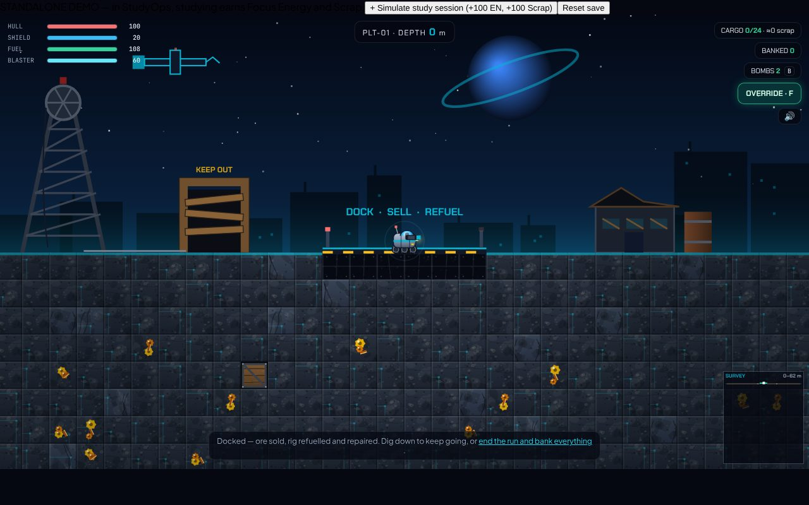
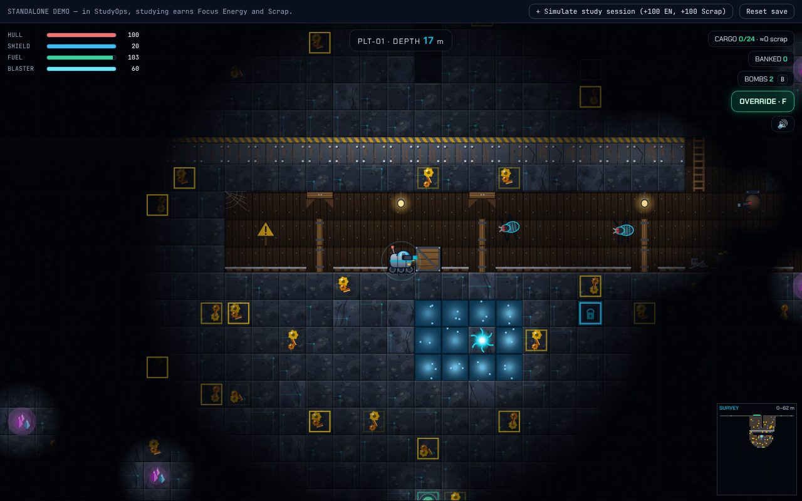
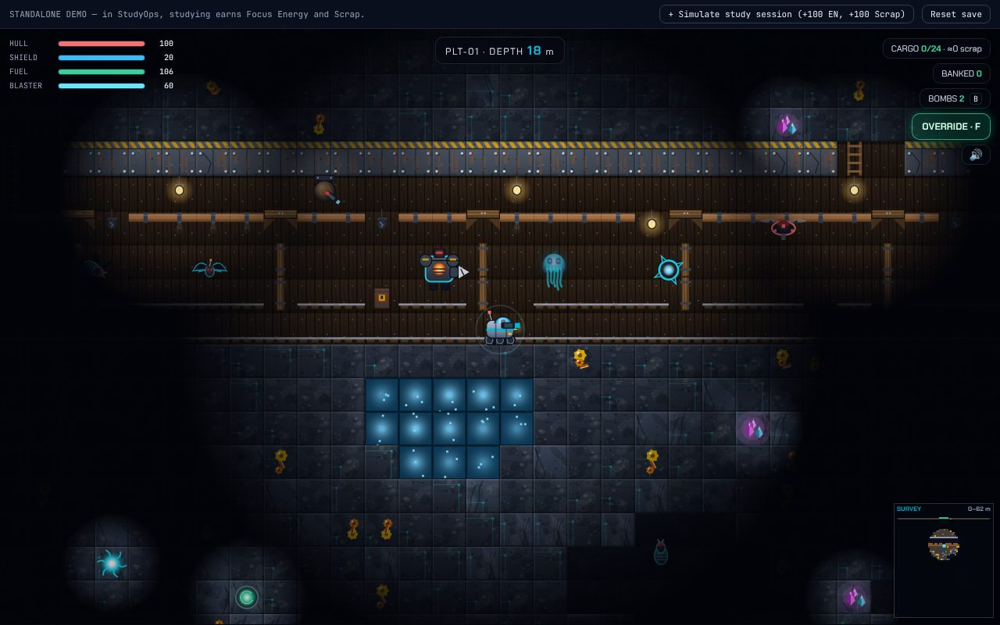
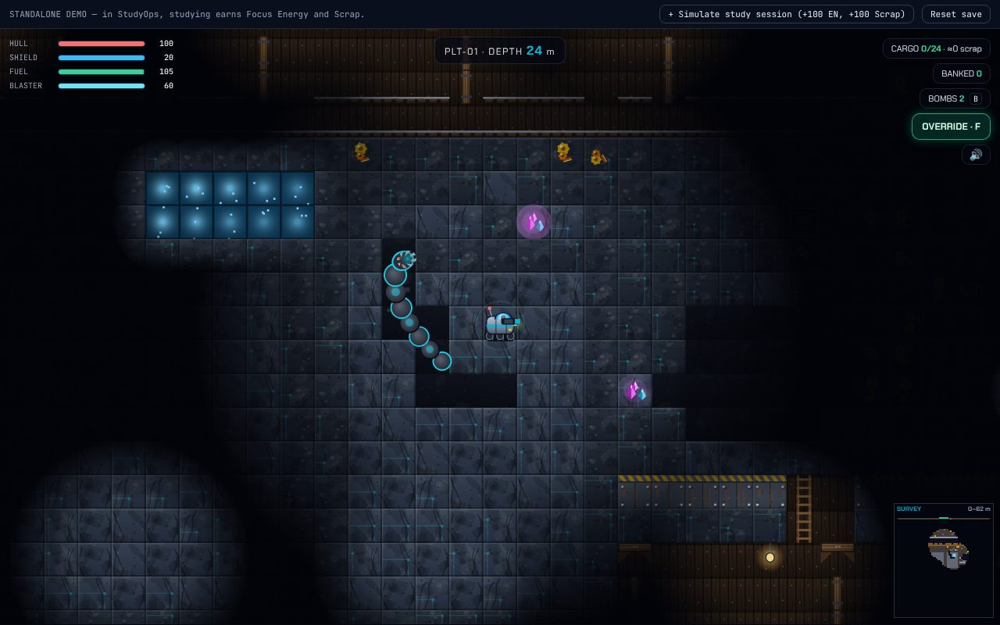
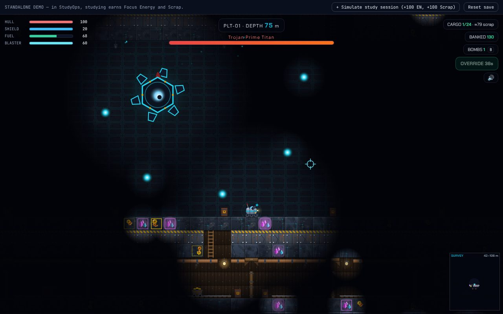

# Core Drill: Planetfall

A break-room arcade game for the **StudyOps** app. You pilot a mining rig into the **abandoned mines of five dead worlds**: timber drifts with rails and dead lamps, rusting plated floors, nests of glitches, and bosses at the bottom. The mine is **endless**: dig as deep as your fuel, your nerve and your headlamp allow. Everything you earn feeds the Armory.







## Play it

Open **`../core-drill.html`** (repo root) in a browser: one self-contained file, no install, progress saved in localStorage. The top bar has "+ Simulate study session" (gives Focus Energy and Scrap like studying would) and "Reset save".

Controls: `A/D` drive, `W` thrusters, `S` dig down (hold `A/D` against rock to dig sideways), mouse or `Space` fire, `B` bomb, `F` flashcard Override, `E` trade with a derelict trader, hold `R` to recall (25% fee away from the pad). Touch devices get an on-screen pad.

## How a run works

- **Levels.** Below 12 m of topsoil the mine is built from 16-row levels. Each has a riveted **steel plate floor** (8 s to drill, or a bomb) with a few **ladder shafts**, a **timber drift** (rails, lamps, carts, crates, pipes, cobwebs), and ore-bearing crust with caves, hazard pockets, nests, flashcard vaults and sealed treasure rooms. You cannot just tunnel straight down: find a shaft, bomb the plate, or pay in fuel.
- **Relays** (every third level) sell your ore and refuel you 50% once. The **pad** at the surface always does. Crates drop fuel, repair kits, bombs, shield cells, scrap and cores.
- **Fog of war.** Your headlamp reaches about 10 tiles at the surface and closes to about 5 by 110 m. Beyond your lamp (and mine lamps, glowing ore, bullets) you see nothing. The **survey minimap** remembers only what your light touched. The Headlamp Array upgrade widens it.
- **Bosses.** Each planet has a **core boss** around 60-130 m deep. Beating it asks: **warp to the next planet** (hull +50%, fuel refilled, cargo and bombs kept) or **stay and keep drilling**. Guardian bosses return every four levels, tougher and better paying, forever.
- **Ending a run.** Recall (`R`), end the run on the pad, or die (half your unsold cargo survives). A run can chain through all five planets.

## Enemies (they move through real tunnels)

| Enemy | Where | Behaviour |
|---|---|---|
| Rust Mite | everywhere | follows tunnels, lunges when close |
| Scrap Bat | from ~15 m | fast, erratic flier through open space |
| Ruined Sentry | drift ceilings | bolted turret, bursts of two when it can see you |
| Drill Worm | from ~25 m | warns with a rumble and cracks, then **eats a visible tunnel** toward you; turns away from plate and bedrock; frost worms slow you |
| Pit Brute | from ~40 m | winds up, then charges; guards treasure rooms |
| Raider Drone | near the surface | arrives from orbit in raids; the pad turret shoots them |
| Phantom (Neural-IX) | everywhere | ghost that drifts through rock, only solid while visible |
| Void Drone (Void-XV) | everywhere | lays mines |

Enemies use a flow field over open tiles, so walls actually stop them and a sealed rig is left alone. Health and damage scale gently with depth.

## Surprises

Cave-in **tremors** drop telegraphed boulders (a 1-wide shaft is a bowling alley). **Signal storms** black out the lamps and send a swarm (survive for a bonus). **Mimic crates** are traps. **Treasure rooms** hide chests, a few guarded by an ambush. **Derelict traders** sell fuel, repairs and bombs for banked scrap. **Rift pockets** on Void-XV throw you across the level; **magma** sets you alight; **vents** slow you; **spore** pockets release phantoms.

## Planets

| Planet | Look | Roster highlights | Core boss |
|---|---|---|---|
| Mainframe-IV | grey-blue server quarry, circuit veins | mites, bats, worms, brutes | Trojan Prime Titan (ring, dash, summon) |
| Foundry-VII | smelter shafts, ember cracks | faster, richer, tougher | Thermal Meltdown Core (ring, aimed fans, spiral, dash) |
| Neural-IX | spore-choked purple tunnels | phantoms, mites | Synapse Devourer AI (sweeping beams, summons) |
| Cryo-XII | ice-locked drifts | frost worms, ice mites | Absolute Zero Kernel (falling ice shards, aimed fans) |
| Void-XV | warped rock | void drones, rifts | Omega Glitch Entity (rings, beams, mines, blinks) |

## Study integration

- **Focus Energy** pays the launch cost (40 / 60 / 80 / 100 / 120).
- **Subject augments**: Math = crit and an ore scanner overlay, Science = bigger shield and damage reduction, CS = faster drill and blaster, Humanities/Languages = more ore value, Arts = speed and damage reduction. **Streak** adds up to +20 fuel.
- **Vault crates** ask a flashcard from the deck; a right answer pays a Neuro-Core. **Override (F)** asks one mid-fight; a right answer fires an EMP that damages everything and restores shield and hull.
- Results flow back through callbacks (launch, run complete, planet cleared, upgrades) so the host banks currencies, advances the daily `game` mission and posts to the squad feed.

## Develop it

```bash
cd core-drill
npm install
npm run dev              # standalone harness with a mock profile -> http://localhost:5174
npm test                 # 79 unit tests: terrain, flow field, AI, worms, bosses, loot, economy, reducers
npm run lint             # tsc --noEmit
npm run build:standalone # rebuilds ../core-drill.html (esbuild, one file)
NODE_PATH=<global node_modules> node tests/e2e/playtest.cjs 'http://127.0.0.1:5174/?debug=1&aug=math,cs&fresh=1' out/
```

Harness URL options: `?en=300&scrap=420&streak=4&aug=math,cs,science,humanities,arts&fresh=1&debug=1` (`debug` exposes `window.__coreDrill.engine` for tests).

## Put it into StudyOps

```bash
python3 integration/apply_to_studyops.py /path/to/studyops
cd /path/to/studyops && npm run lint && npm run build
```

Copies the game to `src/core-drill/` and patches `types/index.ts` (`drill?` on the profile, a `'core-drill'` view), `Header.tsx` (a tab) and `App.tsx` (handlers, mission and squad hooks, `?view=core-drill`). Every edit anchors on text that must appear exactly once, so a drifted app fails loudly. Verified on the uploaded StudyOps build: `tsc` and `vite build` pass.

## Layout

```
src/game/balance.ts   planets, rosters, tiles, upgrades, rig stats, light radius, rewards
src/game/terrain.ts   endless deterministic mine generation (bands, drifts, plates, relays, rooms, boss sites)
src/game/flow.ts      flow field over open tiles for enemy pathing
src/game/engine.ts    DOM-free simulation: rig, digging, combat, AI, worms, bosses, events, warp
src/game/sprites.ts   tile, back-wall and mine-decoration art
src/game/actors.ts    rig, enemies, five bosses, pickups, boulders
src/game/render.ts    scene composition, fog of war, surface ruins, minimap
src/game/sfx.ts       WebAudio effects and generative music
src/game/progress.ts  pure profile reducers
src/components/       CoreDrillGame.tsx + css (orbit map, shop, HUD, modals)
src/harness/          standalone page
tests/                vitest suites + e2e/playtest.cjs
integration/          apply_to_studyops.py
```
